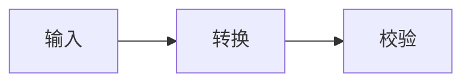

# 一级标题

## 二级标题

### 三级标题

#### 四级标题

##### 五级标题

###### 六级标题

这一段记录产品设计、实现细节与验证结果，保留中文、English 和 emoji 😀。正文采用完整句子，方便观察文字字节数与块结构开销之间的关系。

这一段包含 **加粗**、*斜体*、~~删除线~~、`inlineCode`、[参考链接](https://example.invalid/reference) 和公式 $E=mc^2$。

- 无序条目 1
- 无序条目 2
- 无序条目 3
- 无序条目 4
- 无序条目 5
- 无序条目 6
- 无序条目 7
- 无序条目 8
- 无序条目 9
- 无序条目 10
- 无序条目 11
- 无序条目 12
- 无序条目 13
- 无序条目 14
- 无序条目 15
- 无序条目 16
- 无序条目 17
- 无序条目 18
  - 嵌套子条目

1. 有序步骤 1
2. 有序步骤 2
3. 有序步骤 3
4. 有序步骤 4
5. 有序步骤 5
6. 有序步骤 6
7. 有序步骤 7
8. 有序步骤 8
9. 有序步骤 9
10. 有序步骤 10
11. 有序步骤 11
12. 有序步骤 12
13. 有序步骤 13
14. 有序步骤 14
15. 有序步骤 15
16. 有序步骤 16
17. 有序步骤 17
18. 有序步骤 18

- [ ] 待办事项
- [x] 已完成事项

> 引用中的第一段。
>
> 引用中的第二段，带有 **重点**。

---

```typescript
interface Item { id: string; done: boolean }
const items: Item[] = [{id: "task-1", done: false}];
const pending = items.filter(item => !item.done);
```



$$
\sum_{i=1}^{n} i = \frac{n(n+1)}{2}
$$


| 项目 | 状态 | 数量 | 备注 |
| :--- | :---: | ---: | --- |
| 项目1 | 完成 | 1 | **核对** |
| 项目2 | 完成 | 2 | **核对** |
| 项目3 | 完成 | 3 | **核对** |
| 项目4 | 完成 | 4 | **核对** |
| 项目5 | 完成 | 5 | **核对** |
| 项目6 | 完成 | 6 | **核对** |
| 项目7 | 完成 | 7 | **核对** |
| 项目8 | 完成 | 8 | **核对** |
| 项目9 | 完成 | 9 | **核对** |
| 项目10 | 完成 | 10 | **核对** |
| 项目11 | 完成 | 11 | **核对** |
| 项目12 | 完成 | 12 | **核对** |
| 项目13 | 完成 | 13 | **核对** |
| 项目14 | 完成 | 14 | **核对** |

# 一级标题

## 二级标题

### 三级标题

#### 四级标题

##### 五级标题

###### 六级标题

这一段记录产品设计、实现细节与验证结果，保留中文、English 和 emoji 😀。正文采用完整句子，方便观察文字字节数与块结构开销之间的关系。

这一段包含 **加粗**、*斜体*、~~删除线~~、`inlineCode`、[参考链接](https://example.invalid/reference) 和公式 $E=mc^2$。

- 无序条目 1
- 无序条目 2
- 无序条目 3
- 无序条目 4
- 无序条目 5
- 无序条目 6
- 无序条目 7
- 无序条目 8
- 无序条目 9
- 无序条目 10
- 无序条目 11
- 无序条目 12
- 无序条目 13
- 无序条目 14
- 无序条目 15
- 无序条目 16
- 无序条目 17
- 无序条目 18
  - 嵌套子条目

1. 有序步骤 1
2. 有序步骤 2
3. 有序步骤 3
4. 有序步骤 4
5. 有序步骤 5
6. 有序步骤 6
7. 有序步骤 7
8. 有序步骤 8
9. 有序步骤 9
10. 有序步骤 10
11. 有序步骤 11
12. 有序步骤 12
13. 有序步骤 13
14. 有序步骤 14
15. 有序步骤 15
16. 有序步骤 16
17. 有序步骤 17
18. 有序步骤 18

- [ ] 待办事项
- [x] 已完成事项

> 引用中的第一段。
>
> 引用中的第二段，带有 **重点**。

---

```typescript
interface Item { id: string; done: boolean }
const items: Item[] = [{id: "task-1", done: false}];
const pending = items.filter(item => !item.done);
```


$$
\sum_{i=1}^{n} i = \frac{n(n+1)}{2}
$$


| 项目 | 状态 | 数量 | 备注 |
| :--- | :---: | ---: | --- |
| 项目1 | 完成 | 1 | **核对** |
| 项目2 | 完成 | 2 | **核对** |
| 项目3 | 完成 | 3 | **核对** |
| 项目4 | 完成 | 4 | **核对** |
| 项目5 | 完成 | 5 | **核对** |
| 项目6 | 完成 | 6 | **核对** |
| 项目7 | 完成 | 7 | **核对** |
| 项目8 | 完成 | 8 | **核对** |
| 项目9 | 完成 | 9 | **核对** |
| 项目10 | 完成 | 10 | **核对** |
| 项目11 | 完成 | 11 | **核对** |
| 项目12 | 完成 | 12 | **核对** |
| 项目13 | 完成 | 13 | **核对** |
| 项目14 | 完成 | 14 | **核对** |

# 一级标题

## 二级标题

### 三级标题

#### 四级标题

##### 五级标题

###### 六级标题

这一段记录产品设计、实现细节与验证结果，保留中文、English 和 emoji 😀。正文采用完整句子，方便观察文字字节数与块结构开销之间的关系。

这一段包含 **加粗**、*斜体*、~~删除线~~、`inlineCode`、[参考链接](https://example.invalid/reference) 和公式 $E=mc^2$。

- 无序条目 1
- 无序条目 2
- 无序条目 3
- 无序条目 4
- 无序条目 5
- 无序条目 6
- 无序条目 7
- 无序条目 8
- 无序条目 9
- 无序条目 10
- 无序条目 11
- 无序条目 12
- 无序条目 13
- 无序条目 14
- 无序条目 15
- 无序条目 16
- 无序条目 17
- 无序条目 18
  - 嵌套子条目

1. 有序步骤 1
2. 有序步骤 2
3. 有序步骤 3
4. 有序步骤 4
5. 有序步骤 5
6. 有序步骤 6
7. 有序步骤 7
8. 有序步骤 8
9. 有序步骤 9
10. 有序步骤 10
11. 有序步骤 11
12. 有序步骤 12
13. 有序步骤 13
14. 有序步骤 14
15. 有序步骤 15
16. 有序步骤 16
17. 有序步骤 17
18. 有序步骤 18

- [ ] 待办事项
- [x] 已完成事项

> 引用中的第一段。
>
> 引用中的第二段，带有 **重点**。

---

```typescript
interface Item { id: string; done: boolean }
const items: Item[] = [{id: "task-1", done: false}];
const pending = items.filter(item => !item.done);
```


$$
\sum_{i=1}^{n} i = \frac{n(n+1)}{2}
$$


| 项目 | 状态 | 数量 | 备注 |
| :--- | :---: | ---: | --- |
| 项目1 | 完成 | 1 | **核对** |
| 项目2 | 完成 | 2 | **核对** |
| 项目3 | 完成 | 3 | **核对** |
| 项目4 | 完成 | 4 | **核对** |
| 项目5 | 完成 | 5 | **核对** |
| 项目6 | 完成 | 6 | **核对** |
| 项目7 | 完成 | 7 | **核对** |
| 项目8 | 完成 | 8 | **核对** |
| 项目9 | 完成 | 9 | **核对** |
| 项目10 | 完成 | 10 | **核对** |
| 项目11 | 完成 | 11 | **核对** |
| 项目12 | 完成 | 12 | **核对** |
| 项目13 | 完成 | 13 | **核对** |
| 项目14 | 完成 | 14 | **核对** |

# 一级标题

## 二级标题

### 三级标题

#### 四级标题

##### 五级标题

###### 六级标题

这一段记录产品设计、实现细节与验证结果，保留中文、English 和 emoji 😀。正文采用完整句子，方便观察文字字节数与块结构开销之间的关系。

这一段包含 **加粗**、*斜体*、~~删除线~~、`inlineCode`、[参考链接](https://example.invalid/reference) 和公式 $E=mc^2$。

- 无序条目 1
- 无序条目 2
- 无序条目 3
- 无序条目 4
- 无序条目 5
- 无序条目 6
- 无序条目 7
- 无序条目 8
- 无序条目 9
- 无序条目 10
- 无序条目 11
- 无序条目 12
- 无序条目 13
- 无序条目 14
- 无序条目 15
- 无序条目 16
- 无序条目 17
- 无序条目 18
  - 嵌套子条目

1. 有序步骤 1
2. 有序步骤 2
3. 有序步骤 3
4. 有序步骤 4
5. 有序步骤 5
6. 有序步骤 6
7. 有序步骤 7
8. 有序步骤 8
9. 有序步骤 9
10. 有序步骤 10
11. 有序步骤 11
12. 有序步骤 12
13. 有序步骤 13
14. 有序步骤 14
15. 有序步骤 15
16. 有序步骤 16
17. 有序步骤 17
18. 有序步骤 18

- [ ] 待办事项
- [x] 已完成事项

> 引用中的第一段。
>
> 引用中的第二段，带有 **重点**。

---

```typescript
interface Item { id: string; done: boolean }
const items: Item[] = [{id: "task-1", done: false}];
const pending = items.filter(item => !item.done);
```


$$
\sum_{i=1}^{n} i = \frac{n(n+1)}{2}
$$


| 项目 | 状态 | 数量 | 备注 |
| :--- | :---: | ---: | --- |
| 项目1 | 完成 | 1 | **核对** |
| 项目2 | 完成 | 2 | **核对** |
| 项目3 | 完成 | 3 | **核对** |
| 项目4 | 完成 | 4 | **核对** |
| 项目5 | 完成 | 5 | **核对** |
| 项目6 | 完成 | 6 | **核对** |
| 项目7 | 完成 | 7 | **核对** |
| 项目8 | 完成 | 8 | **核对** |
| 项目9 | 完成 | 9 | **核对** |
| 项目10 | 完成 | 10 | **核对** |
| 项目11 | 完成 | 11 | **核对** |
| 项目12 | 完成 | 12 | **核对** |
| 项目13 | 完成 | 13 | **核对** |
| 项目14 | 完成 | 14 | **核对** |

这一段记录产品设计、实现细节与验证结果，保留中文、English 和 emoji 😀。正文采用完整句子，方便观察文字字节数与块结构开销之间的关系。这一段记录产品设计、实现细节与验证结果，保留中文、English 和 emoji 😀。正文采用完整句子，方便观察文字字节数与块结构开销之间的关系。这一段记录产品设计、实现细节与验证结果，保留中文、English 和 emoji 😀。正文采用完整句子，方便观察文字字节数与块结构开销之间的关系。这一段记录产品设计、实现细节与验证结果，保留中文、English 和 emoji 😀。正文采用完整句子，方便观察文字字节数与块结构开销之间的关系。这一段记录产品设计、实现细节与验证结果，保留中文、English 和 emoji 😀。正文采用完整句子，方便观察文字字节数与块结构开销之间的关系。这一段记录产品设计、实现细节与验证结果，保留中文、English 和 emoji 😀。正文采用完整句子，方便观察文字字节数与块结构开销之间的关系。这一段记录产品设计、实现细节与验证结果，保留中文、English 和 emoji 😀。正文采用完整句子，方便观察文字字节数与块结构开销之间的关系。xxxxxxxxxxxxxxxx

